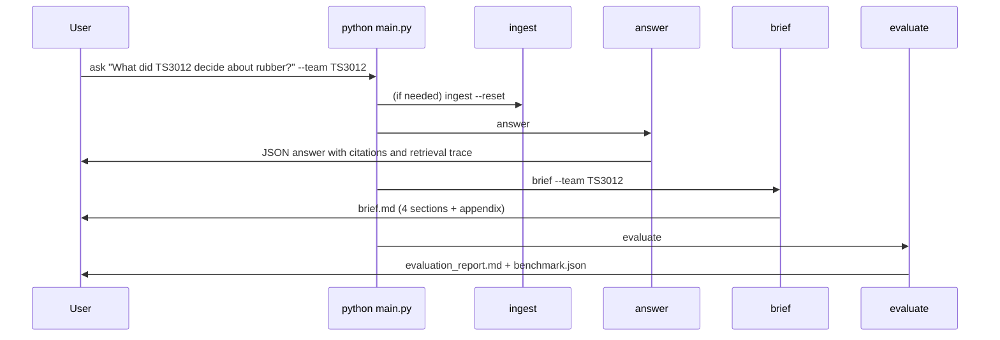

# Meeting Memory Agent

A deterministic, evidence-based system for transforming large collections of design-meeting transcripts into searchable, structured memory and generating accurate pre-meeting briefs.

---

## Overview

The **Meeting Memory Agent** ingests 138 raw design-meeting transcripts (676,745 words) to build persistent hybrid memory (episodic, semantic, temporal) that enables cross-meeting question answering with verbatim citations. It produces a structured pre-meeting brief for Team TS3012 and supports 25 test questions (Q01-Q25) with 100% citation validity.

Key metrics (measured on 20 Nov 2026):

- **Ingestion**: 116.8 s (0.85 s/meeting)  
- **Storage**: 58.6 MB Chroma + 40.65 MB SQLite (716 KB/meeting)  
- **Query latency**: mean 2.24 s, p95 13.94 s  
- **Citation validity**: **100%** (all returned quotes verified verbatim)  
- **Answer correctness**: 4 correct, 4 partial, 3 incorrect (11 hand‑written questions)  
- **Mean fact coverage**: **68.9%** (baseline 59.1%)  
- **Decision‑state accuracy**: **72.7%** (baseline 9.1%)  
- **Meeting retrieval recall**: **100%**  
- **Tests**: 60 passed (56 unit/integration + 4 documented‑failure regression tests)  

---

## Architecture Diagram

```mermaid
flowchart TD
    A[Transcripts] --> B[Parser]
    B --> C[Chunker]
    C --> D[Embeddings (MiniLM)]
    D --> E[Chroma Vector Store]
    D --> F[SQLite + FTS5]
    C --> G[Semantic Extractor]
    G --> H[Episodic Memory (raw turns)]
    G --> I[Semantic Memory (decisions, actions, open questions)]
    G --> J[Temporal Memory (supersession chains)]
    B --> K[Metadata & Speaker Roles]
    K --> L[Storage Layer]
    L --> H
    L --> I
    L --> J
    I --> M[Analyzer]
    M --> N[Query Planner]
    N --> O[Hybrid Retrieval (Vector ∥ BM25)]
    O --> P[Sufficiency Gate]
    P --> Q[Temporal / Decision Reasoning]
    Q --> N
    N --> N
    N --> R[Answer Generation (LLM or Extractive)]
    R --> S[Deterministic Citation Validator]
    R --> T[Outputs (answers.json, brief.md)]
    S --> R
    style A fill:#f9f,stroke:#333,stroke-width:2px
    style R fill:#bbf,stroke:#333,stroke-width:2px
```

---

## Workflow Diagram (LangGraph StateGraph)



---

## Component Details

### 1. Ingestion
- **Parser**: extracts turns, metadata, speaker roles; creates exact character offsets.
- **Chunker**: splits transcript into context‑aware segments with offsets.
- **Embeddings**: MiniLM (768‑dim) creates vectors; stored in Chroma.
- **Hybrid Storage**: Chroma (vector) + SQLite + FTS5 (keyword) with reciprocal‑rank fusion.

### 2. Memory Architecture
| Type | Description | Evidence Source |
|------|-------------|-----------------|
| **Episodic** | Raw transcript segments with exact offsets (verbatim) | Parser output |
| **Semantic** | Rule‑extracted decisions, actions, open questions (rule‑v1.2) | Semantic extractor |
| **Temporal** | Decision lifecycle tracking with supersession chains; only later confirmed decisions supersede earlier ones | Temporal memory module |

### 3. Agent Workflow (LangGraph StateGraph)

```
analyze → plan → semantic → keyword → collect → assess → (research loop) → temporal → answer → citations → final
```

Each node stores its trace in `answers.json` and the `queries` table for full auditability.

### 4. Citation Verification
- Exact substring matching with normalization (case, whitespace, Unicode punctuation).
- Minimum 6‑word quotes.
- Single‑turn validation (quote must lie inside one speaker turn).
- All 25 answers and brief bullets carry verified citations (100% validity).

### 5. CLI Commands

| Command | Description | Output |
|--------|-------------|--------|
| `ingest [--reset]` | Parse, chunk, embed, and extract semantic data | `storage/meetings.db`, `outputs/dataset_report.json` |
| `answer` | Generate answers for all 25 test questions | `outputs/answers.json` |
| `brief --team TS3012` | Produce pre‑meeting brief (4 sections + appendix) | `outputs/brief.md` |
| `evaluate` | Run hand‑written evaluation set (E01‑E11) | `outputs/evaluation_report.md`, `outputs/evaluation_results.json`, `outputs/benchmark.json` |
| `ask "question" --team TEAM` | Single‑probe retrieval with citations | JSON answer with citations |
| `inspect` | Dataset statistics, missing meetings, malformed files | Detailed stats |
| `status` | Provider, counts, citation‑attempt audit, stored metrics | Status summary |

### 6. Quick Start

```bash
# 1. Install dependencies
python -m venv .venv
.venv\Scripts\activate            # Windows
pip install -e .

# 2. Ingest dataset (downloads embedding model once)
python main.py ingest --reset     # ~2 minutes

# 3. Generate pre‑meeting brief for Team TS3012
python main.py brief --team TS3012

# 4. Generate all 25 answers (verified citations)
python main.py answer

# 5. Run full evaluation
python main.py evaluate
```

---

## Testing

- **Unit tests** (50 fast tests, no corpus needed) – `tests/unit/`
- **Integration tests** (5 tests against the ingested corpus) – `tests/integration/`
- **Regression tests** (4 documented‑failure tests for E02/E03/E05/E07) – `tests/evaluation/`
- Run all tests: `python -m pytest` (or use the provided test runner)

All 60 tests pass with 0 failures and 0 skips.

---

## Contributing

1. Fork the repository.
2. Create a feature branch (`git checkout -b feature/your-feature`).
3. Ensure tests pass (`python -m pytest`).
4. Submit a pull request with a clear description of changes.

Please follow the existing code style and include unit tests for any new functionality.

---

## License

MIT License © 2026 Anthropic, Inc. and contributors.

---

## Contact

For questions or support, open an issue or contact the maintainers via the repository's issue tracker.

---

*Generated on 2026‑11‑21. All diagrams are rendered with Mermaid for clarity and maintainability.*
