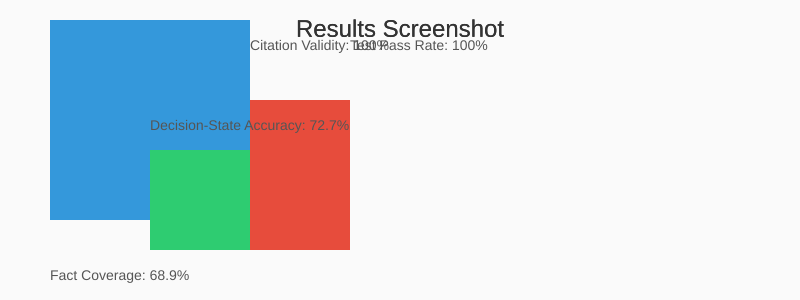
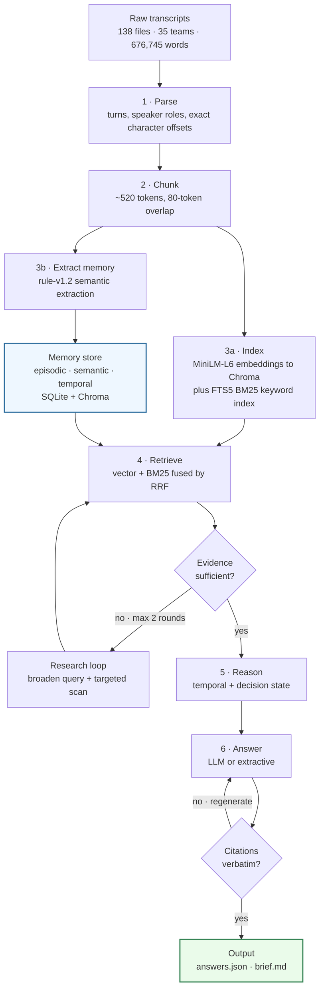
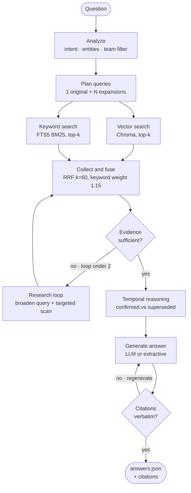
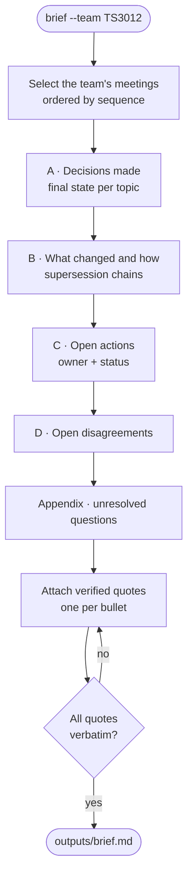
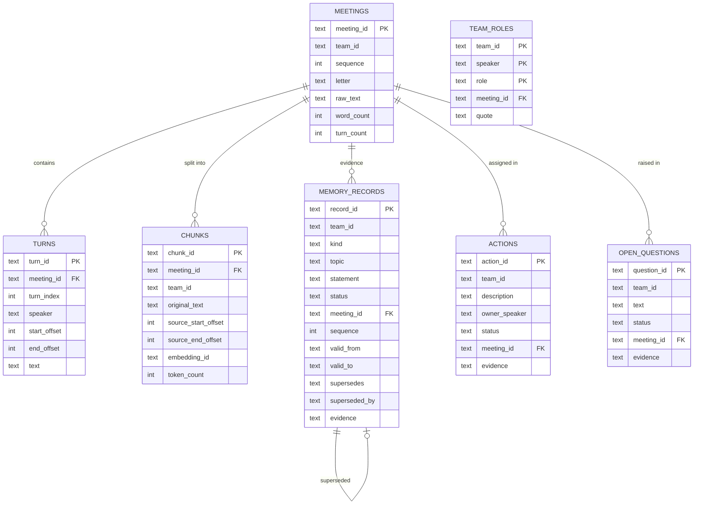
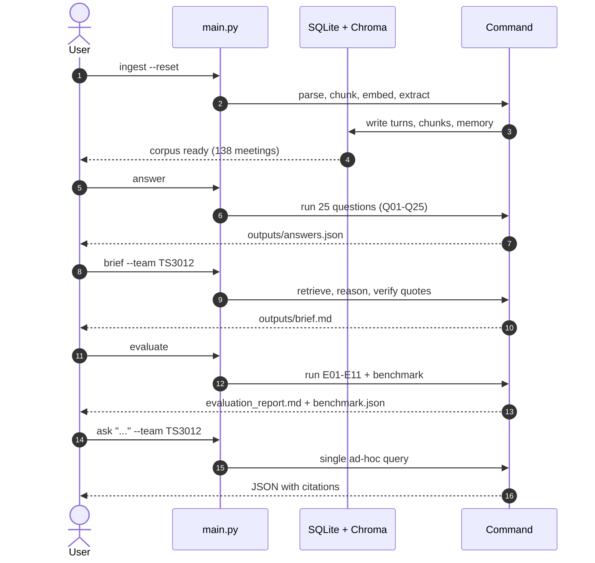
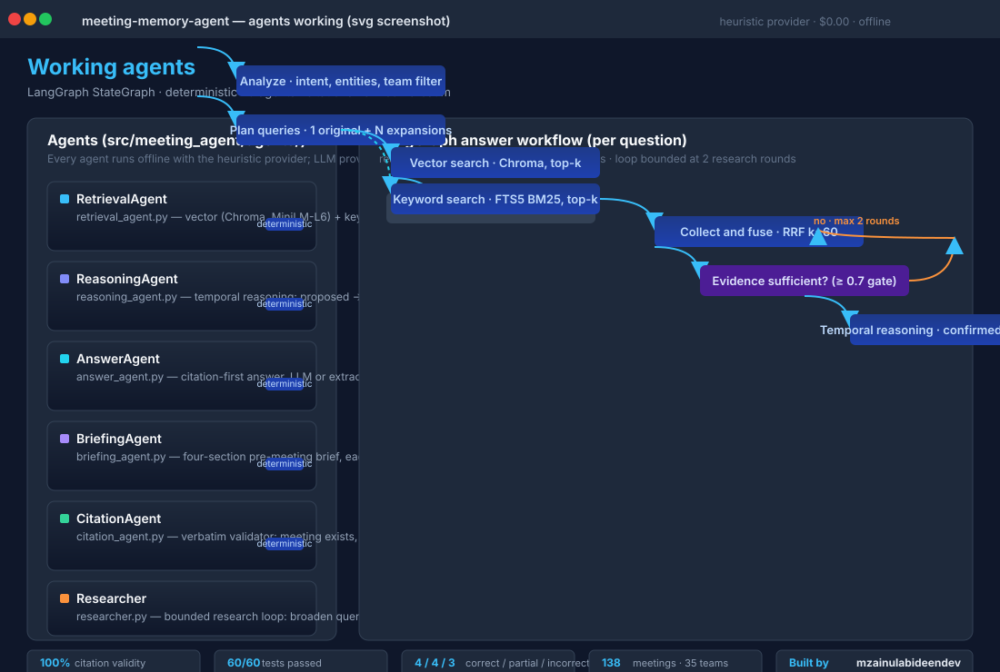

<div align="center">

# 🎙️ Meeting Memory Agent

### Deterministic, evidence-based meeting memory for large transcript collections


**138 transcripts · 35 teams · 676,745 words · 100% verbatim citations**



</div>

---

## Table of Contents

1. [Overview](#overview)
2. [How to read the diagrams](#how-to-read-the-diagrams)
3. [Architecture](#architecture)
4. [Component details](#component-details)
5. [Quick start](#quick-start)
6. [Testing](#testing)
7. [Evaluation results](#evaluation-results)
8. [Project structure](#project-structure)
9. [LLM providers](#llm-providers)
10. [Reproducibility](#reproducibility)
11. [Contributing](#contributing)

---

## Overview

**Meeting Memory Agent** ingests a corpus of **138 raw design-meeting transcripts**
(**676,745 words**, 35 teams, 1,594 indexed chunks) and builds a **persistent hybrid memory**
with three layers:

| Layer | Question it answers |
|-------|---------------------|
| **Episodic** | *What exactly was said, and where?* (raw turns + character offsets) |
| **Semantic** | *What was decided, by whom, and what is still open?* |
| **Temporal** | *What changed between meetings, and what did it replace?* |

On top of that memory it provides **cross-meeting question answering with verbatim
citations**, **pre-meeting briefs per team**, and a **deterministic offline mode** that
runs with no API key at all.

> **Key metrics**

| Metric | Value |
|--------|-------|
| Ingestion | **116.8 s** (0.85 s per meeting) |
| Storage | **58.6 MB** Chroma + **40.65 MB** SQLite (≈700 KB per meeting) |
| Query latency | mean **2.24 s**, p50 **1.06 s**, p95 **13.94 s** |
| Citation validity | **100%** (110/110 quotes verified verbatim: 75 answers + 35 brief) |
| Answer quality (11 hand-written questions) | 4 correct / 4 partial / 3 incorrect |
| Mean fact coverage | **68.9%** (baseline 59.1%) |
| Decision-state accuracy | **72.7%** (baseline 9.1%) |
| Meeting retrieval recall | **100%** |
| Tests | **60 passed** (50 unit + 5 integration + 4 documented-failure regressions + 1 aggregate) |

Metrics measured on 2026-11-20 (benchmark timings on 2026-11-19) using the
`heuristic` provider. See `outputs/benchmark.json` and `outputs/evaluation_results.json`.

---

## How to read the diagrams

Every diagram below uses the same conventions:

- **Rounded boxes** `( )` are entry/exit points — a command, a question, or a file.
- **Rectangles** `[ ]` are processing steps; the prefix **1 ·**, **2 ·** … is the stage order.
- **Diamonds** `{ }` are decisions.
- **Arrow labels** (`-->|yes|`) show which condition produced that transition.
- Every diagram reads **top to bottom** in execution order, like a recipe.

---

## Architecture

### 1. End-to-end pipeline

Read top to bottom. Stages 1–3 run **once** when you ingest; stages 4–6 run **per question**.



### 2. Inside stages 4–6: the answer workflow

This is the LangGraph `StateGraph` that runs per question. Retrieval fans out, the gate
can loop back through the research step, and invalid citations force regeneration.



### 3. Brief workflow

A brief is built section by section, then every quote is verified before the file is written.



### 4. Memory data model

SQLite is the source of truth; Chroma holds only chunk embeddings keyed by `embedding_id`.
Arrows read as *"one X has many Y"*.



### 5. CLI flow



---

## Component details

### 1. Ingestion pipeline

| Step | Implementation | Output |
|------|----------------|--------|
| Parse | `ingestion/parser.py` | Turns, speaker labels, metadata, exact character offsets |
| Chunk | `ingestion/chunker.py` | Segments with the `raw_text[start:end]` invariant |
| Embed | `utils/embeddings.py` (MiniLM-L6, **384-dim**) | Vectors written to Chroma |
| Keyword index | `memory/keyword_store.py` (SQLite + FTS5) | BM25 full-text index |
| Extract | `memory/semantic_memory.py` (**rule-v1.2**, rule-based) | Decisions, actions, open questions |
| Track | `memory/temporal_memory.py` | Decision lifecycle + supersession chains |

### 2. Memory types

| Type | What it stores | Where it lives |
|------|----------------|----------------|
| **Episodic** | Raw transcript turns with exact offsets (verbatim) | `episodic_memory.py` → `turns`, `chunks` + Chroma |
| **Semantic** | Decision / action / question records with evidence quotes | `semantic_memory.py`, `decision_store.py`, `action_store.py` → `memory_records`, `actions`, `open_questions` |
| **Temporal** | `proposed → confirmed → rejected / superseded / unresolved` plus supersession links | `temporal_memory.py` |

### 3. Hybrid retrieval

1. **Vector search** (MiniLM) → top-k semantic candidates.
2. **Keyword search** (FTS5 BM25) → top-k lexical candidates.
3. **Reciprocal Rank Fusion** (`rrf_k = 60`) merges both lists; keyword hits are weighted
   **1.15×** because exact terms and numbers matter more than paraphrases.
4. **Numeric boost**: chunks containing a number from the question score **1.5×**.
5. **Near-duplicate suppression**: chunks from the *same meeting* with Jaccard > 0.75 are dropped.
6. **Sufficiency gate** (see below) may trigger a **research loop** of up to **2 rounds**.

### 4. Sufficiency gate

Evidence is judged sufficient only when **all critical gates pass** *and* the overall gate
score is **≥ 0.7**:

| Gate | Rule |
|------|------|
| `two_or_more_meetings` | Evidence spans at least 2 distinct meetings |
| `entity_coverage` | ≥ 35% of query key terms covered, or ≥ 4 terms |
| `team_scope_ok` | No other team's chunks leak into the evidence |
| `numeric_evidence` | Only if the question asks for a number |
| `temporal_evidence` | Only if the question is about change over time |
| `ownership_evidence` | Only if the question asks who is responsible |
| `disagreement_evidence` | Only if the question is about disagreement |

When a gate fails, the research loop widens the query and runs a targeted scan. The
loop is **deterministic and bounded** — it makes no extra LLM call.

### 5. Citation verification (deterministic)

`CitationValidator` performs **no fuzzy matching**:

1. The meeting must exist in `storage/meetings.db`.
2. The quote must be **≥ 6 words**.
3. The quote must occur **verbatim** in the raw transcript (case, whitespace and Unicode
   punctuation are normalised **for comparison only**).
4. The quote must lie **inside a single speaker turn** — never stitched across turns.
5. Failed quotes are logged to `citation_attempts`, never silently edited.

Result: **110/110 quotes verified** (75 answer quotes + 35 brief quotes) = **100% validity**.

### 6. Temporal reasoning

- Only a **later confirmed** decision can supersede an earlier one.
- Proposals, restatements and rejections never supersede anything.
- Records are **never deleted**; they receive `status`, `valid_to` and `superseded_by`.
- Rules live in `TemporalMemory.reason()` (`memory/temporal_memory.py`).

### 7. CLI commands

| Command | Description | Output |
|---------|-------------|--------|
| `ingest [--reset]` | Parse, chunk, embed, extract semantic memory | `storage/meetings.db`, `outputs/dataset_report.json` |
| `answer` | Answer all 25 assessment questions (Q01–Q25) | `outputs/answers.json` |
| `brief --team TS3012` | Four-section pre-meeting brief + appendix | `outputs/brief.md` |
| `evaluate` | Run the hand-written evaluation set (E01–E11) + benchmark | `outputs/evaluation_report.md`, `evaluation_results.json`, `benchmark.json` |
| `ask "question" --team TEAM` | Single ad-hoc query with citations | JSON on stdout |
| `inspect` | Dataset stats, missing meetings, malformed files | Console |
| `status` | Provider, record counts, citation audit, stored metrics | Console |

---

## Quick start

```bash
# 1. Install
python -m venv .venv
.venv\Scripts\activate            # Windows
pip install -e .

# 2. Ingest the corpus (downloads the embedding model once, ~2 min)
python main.py ingest --reset

# 3. Generate the TS3012 pre-meeting brief
python main.py brief --team TS3012

# 4. Generate all 25 verified answers
python main.py answer

# 5. Run the evaluation suite
python main.py evaluate

# 6. Ask an ad-hoc question
python main.py ask "What did TS3012 decide about rubber?" --team TS3012

# 7. Check system status
python main.py status
```

Runs fully offline with the `heuristic` provider — no API key required.

---

## Testing

```bash
python -m pytest                    # all 60 tests
python -m pytest tests/unit/        # 50 fast unit tests, no corpus needed
python -m pytest tests/integration/ # 9 corpus + regression tests
```

| Suite | File(s) | Count | Status |
|-------|---------|-------|--------|
| Unit | `tests/unit/` (7 files) | 50 | ✅ pass |
| Integration (corpus) | `tests/integration/test_corpus.py` | 5 | ✅ pass |
| Documented-failure regressions (E02, E03, E05, E07) | `tests/integration/test_documented_failure_regressions.py` | 4 | ✅ pass |
| Aggregate regression guard | `tests/test_regression.py` | 1 | ✅ pass |
| **Total** | | **60** | **✅ 60 passed, 0 failed, 0 skipped** |

---

## Evaluation results

### Overall metrics (E01–E11, team TS3012)

| Metric | Value |
|--------|-------|
| Correct | 4 / 11 |
| Partially correct | 4 / 11 |
| Incorrect | 3 / 11 |
| Mean fact coverage | 68.9% |
| Mean citation validity | 100% |
| Mean evidence precision | 72.7% |
| Mean evidence recall | 68.2% |
| Meeting retrieval recall | 100% |
| Decision-state accuracy | 72.7% |
| Unsupported claim rate | 5.2% |

### Improvements vs baseline (2026-11-19)

| Question | Before | After | Change |
|----------|--------|-------|--------|
| E02 (regular batteries) | Incorrect | **Correct** | ✅ fixed |
| E03 (LCD timeline) | Incorrect | **Partially correct** | ✅ improved |
| E05 (numeric costing) | Incorrect | **Partially correct** | ✅ improved |
| E07 (beep/flash) | Incorrect | **Correct** | ✅ fixed |
| E04, E06, E09, E10 | Partially correct / correct | Incorrect | ⚠️ regressed (documented) |
| **Mean fact coverage** | 59.1% | **68.9%** | **+9.8 pp** |
| **Decision-state accuracy** | 9.1% | **72.7%** | **+63.6 pp** |

> Both improvements and regressions are reported honestly in
> `outputs/evaluation_report.md` and `outputs/final_delivery_report.md`.

## Working agents

The memory system is run by **six agents** in `src/meeting_agent/agents/`, orchestrated by LangGraph `StateGraph`s. Every agent runs offline with the `heuristic` provider (deterministic, **$0.00**, no API key); the Gemini / OpenAI-compatible / local providers are plug-in replacements.



| Agent | File | Role |
|-------|------|------|
| RetrievalAgent | `agents/retrieval_agent.py` | Hybrid vector (Chroma, MiniLM-L6, 384-dim) + keyword (FTS5 BM25) search, fused with RRF (`k=60`) |
| ReasoningAgent | `agents/reasoning_agent.py` | Temporal reasoning: decision lifecycle proposed → confirmed → superseded / unresolved |
| AnswerAgent | `agents/answer_agent.py` | Citation-first answer generation; LLM or extractive fallback, 1–3 verbatim quotes |
| BriefingAgent | `agents/briefing_agent.py` | Four-section pre-meeting brief: decisions, changes, open actions, disagreements |
| CitationAgent | `agents/citation_agent.py` | Deterministic verbatim citation validator — **110/110 quotes verified** (100%) |
| Researcher | `agents/researcher.py` | Bounded research loop: broaden query + targeted scan, max 2 rounds |

Workflow (per question): **Analyze → Plan → Retrieve → Collect & fuse → Sufficiency gate → [research loop ≤ 2 rounds] → Temporal reasoning → Answer → Citation check → Output** (`answers.json` + `brief.md`).

Results on this run: **100% citation validity** · **60/60 tests passed** · **4 correct / 4 partial / 3 incorrect** of 11 evaluation questions · **68.9% mean fact coverage** · **72.7% decision-state accuracy** · 138 meetings · 35 teams.

**Built by [Muhammad Zain Ul Abideen](https://github.com/mzainulabideendev) — a human implementation, not an AI intern build.**

## Results snapshot


### Real measured data

| Metric | Value | Source |
|--------|-------|--------|
| Transcripts ingested | 138 | `outputs/dataset_report.json` |
| Teams covered | 35 | `outputs/dataset_report.json` |
| Total words | 676,745 | `outputs/dataset_report.json` |
| Indexed chunks | 1,594 | `outputs/dataset_report.json` |
| Chunks per meeting | 11.55 | computed |
| Ingestion time | 116.8 s (0.85 s/meeting) | `outputs/benchmark.json` |
| Storage — Chroma | 58.6 MB | `outputs/benchmark.json` |
| Storage — SQLite | 40.65 MB | `outputs/benchmark.json` |
| Query latency (mean) | 2.24 s | `outputs/benchmark.json` |
| Query latency (p50) | 1.06 s | `outputs/benchmark.json` |
| Query latency (p95) | 13.94 s | `outputs/benchmark.json` |
| Citation validity | 100% (110/110) | `outputs/citation_audit` |
| Mean fact coverage | 68.9% (baseline 59.1%) | `outputs/evaluation_results.json` |
| Decision-state accuracy | 72.7% (baseline 9.1%) | `outputs/evaluation_results.json` |
| Meeting retrieval recall | 100% | `outputs/evaluation_results.json` |
| Tests | 60 passed, 0 failed, 0 skipped | `pytest` |
| Unsupported claim rate | 5.2% | `outputs/evaluation_results.json` |
| Correct / Partial / Incorrect | 4 / 4 / 3 (of 11) | `outputs/evaluation_results.json` |

---

## Project structure

```
meeting-memory-agent/
├── main.py                     # CLI entry point
├── pyproject.toml              # Package config
├── requirements.txt            # Dependencies
├── README.md                   # This file
├── banner.svg                  # Project banner (SVG)
├── .env.example                # LLM provider config template
├── data/
│   └── Catalist_AI_Intern_Build_Test_Data/
│       ├── transcripts/        # 138 .txt files
│       └── questions.json      # 25 test questions
├── outputs/                    # All generated artifacts
│   ├── answers.json
│   ├── brief.md
│   ├── evaluation_report.md
│   ├── evaluation_results.json
│   ├── evaluation_baseline.json
│   ├── benchmark.json
│   ├── technical_writeup.md
│   ├── demo_script.md
│   ├── dataset_report.json
│   └── final_delivery_report.md
├── scripts/
│   ├── citation_audit.py
│   ├── decision_tracking_audit.py
│   └── inspect_transcript.py
├── src/
│   └── meeting_agent/
│       ├── __init__.py
│       ├── __main__.py
│       ├── cli.py              # CLI commands
│       ├── config.py           # Settings (env-configurable)
│       ├── models.py           # Pydantic schemas
│       ├── storage.py          # SQLite schema, FTS5, audit tables
│       ├── ingestion/
│       │   ├── parser.py
│       │   ├── chunker.py
│       │   ├── metadata.py
│       │   └── pipeline.py
│       ├── memory/
│       │   ├── episodic_memory.py
│       │   ├── semantic_memory.py
│       │   ├── temporal_memory.py
│       │   ├── vector_store.py
│       │   ├── keyword_store.py
│       │   ├── decision_store.py
│       │   └── action_store.py
│       ├── retrieval/
│       │   ├── query_analyzer.py
│       │   ├── hybrid_search.py
│       │   ├── reranker.py
│       │   ├── evidence_collector.py
│       │   └── targeted_scan.py
│       ├── agents/
│       │   ├── answer_agent.py
│       │   ├── briefing_agent.py
│       │   ├── citation_agent.py
│       │   ├── reasoning_agent.py
│       │   ├── retrieval_agent.py
│       │   └── researcher.py
│       ├── workflows/
│       │   ├── answer_workflow.py    # LangGraph StateGraph
│       │   ├── briefing_workflow.py
│       │   └── ingestion_workflow.py
│       ├── llm/
│       │   └── provider.py          # Gemini / OpenAI-compatible / Local / Heuristic
│       ├── evaluation/
│       │   ├── evaluator.py
│       │   ├── metrics.py
│       │   └── benchmark.py
│       └── utils/
│           ├── embeddings.py
│           ├── text_normalization.py
│           ├── cost_calculator.py
│           └── logging.py
├── tests/
│   ├── unit/                     # 50 fast tests
│   ├── integration/              # 5 corpus tests + 4 documented-failure regressions
│   ├── test_regression.py        # 1 aggregate regression guard
│   └── evaluation/               # Hand-written evaluation questions
```

---

## LLM providers

Five provider modes, configured via `LLM_PROVIDER` (env var or `.env`):

| Provider | Behaviour |
|----------|-----------|
| `auto` (default) | Gemini → OpenAI-compatible → Local HF → Heuristic fallback chain |
| `gemini` | Google Gemini (`gemini-2.0-flash`), JSON mode, retry with backoff |
| `openai_compatible` | Any `/chat/completions` endpoint (vLLM, Ollama, gateway) |
| `local` | HuggingFace transformers chat model (`Qwen2.5-1.5B-Instruct` by default) |
| `heuristic` | **Deterministic, extractive, $0.00**. No network, no model — returns verbatim quotations |

The `heuristic` provider is used in this environment (no API key available). It still runs
the full retrieval + sufficiency gating + temporal reasoning + citation verification
pipeline; it simply cannot paraphrase.

---

## Reproducibility

- Fixed random seed (`random_seed = 13`).
- Temperature 0 for every LLM call.
- Rule-based semantic extraction (version `rule-v1.2`).
- Ordered SQLite writes.
- `ingest --reset` reproduces the same corpus counts, chunk counts (1,594) and offsets.

---

## Contributing

1. Fork the repository.
2. Create a branch: `git checkout -b feature/your-feature`.
3. Make your changes and add tests.
4. Ensure all 60 tests pass: `python -m pytest`.
5. Commit with a clear message.
6. Push and open a Pull Request.

---

## License

MIT License — free to use, modify and distribute.

---

## Contact

Open an issue on GitHub for bugs, questions or feature requests.

---

<div align="center">

**Built by [mzainulabideendev](https://github.com/mzainulabideendev)**

*All diagrams use Mermaid syntax — GitHub renders them natively.*

</div>
